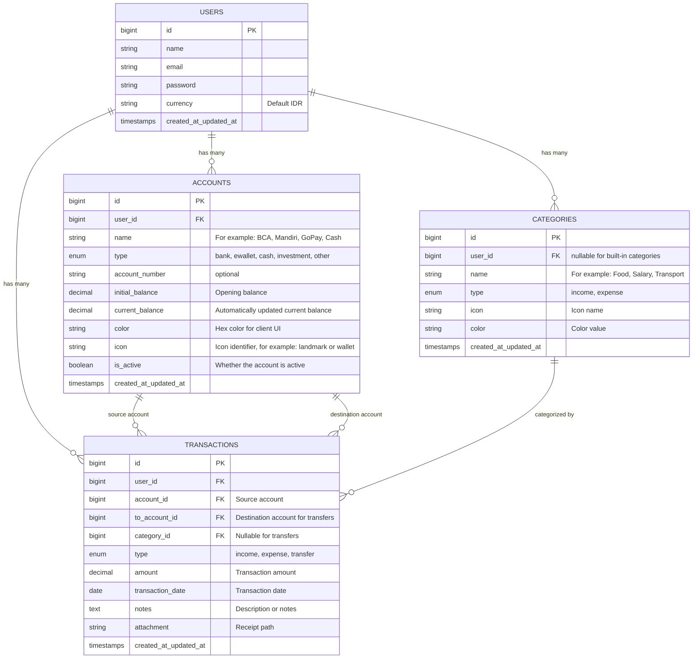
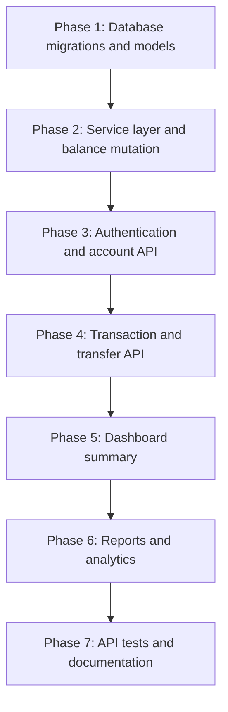

# Blueprint & Implementation Plan: Personal Finance Tracker

This document describes the existing Laravel backend and the planned React frontend for a personal finance tracking application. The frontend is planned as a separate React single-page application (SPA) that consumes this project's REST API. See [`design.md`](./design.md) for the frontend's visual direction, screens, and interactions.

## 1. Backend Vision and Scope

The backend provides a central headless API for tracking monthly income and expenses, balances across bank accounts and e-wallets, total net balance, and financial reports.

1. **Multi-account and e-wallet tracking:** Track bank accounts, digital wallets, cash, investments, and other account types.
2. **Total net balance:** Aggregate the current balance of active accounts.
3. **Income and expense tracking:** Record transactions and organize them by category.
4. **Internal transfers:** Move funds between accounts atomically without counting transfers as spending.
5. **Analytics and financial reports:** Provide monthly summaries, cashflow trends, category breakdowns, account distribution, and CSV exports.

## 2. Backend Technology Stack

| Component | Specification |
| :--- | :--- |
| Framework | Laravel 11 / 12 (PHP 8.2+) |
| Architecture | Headless RESTful JSON API |
| API authentication | Laravel Sanctum |
| Database | MySQL / MariaDB |
| ORM and business logic | Eloquent ORM and service layer pattern |
| Response and validation | Laravel JSON responses and request validation |
| Documentation and testing | Postman Collection / OpenAPI and PHPUnit / Pest feature tests |

## 3. Database Schema



### Balance integrity rules (ACID)

All account balance changes must run inside `DB::transaction()`:

- **Income:** `account.current_balance += amount`
- **Expense:** `account.current_balance -= amount`
- **Transfer:** subtract from `account_id.current_balance` and add to `to_account_id.current_balance`.
- **Update transaction:** reverse the old balance change, then apply the updated transaction.
- **Delete transaction:** restore the account balance to its previous state.

## 4. REST API Specification

The public authentication endpoints do not require authentication. Other finance endpoints are protected by the `auth:sanctum` middleware. The standard JSON response shape is:

```json
{
  "success": true,
  "message": "Response description",
  "data": {}
}
```

### 4.1 Authentication (`/api/auth`)

| Method | Endpoint | Description |
| :--- | :--- | :--- |
| `POST` | `/api/auth/register` | Register a new user |
| `POST` | `/api/auth/login` | Log in and receive a Sanctum token |
| `POST` | `/api/auth/logout` | Revoke the current token |
| `GET` | `/api/auth/me` | Get the authenticated user's profile |

### 4.2 Account management (`/api/accounts`)

| Method | Endpoint | Description |
| :--- | :--- | :--- |
| `GET` | `/api/accounts` | Get active accounts, balances, and balance breakdown |
| `POST` | `/api/accounts` | Create an account |
| `GET` | `/api/accounts/{id}` | Get an account |
| `PUT/PATCH` | `/api/accounts/{id}` | Update account details |
| `DELETE` | `/api/accounts/{id}` | Archive an account |
| `POST` | `/api/accounts/{id}/reconcile` | Manually reconcile an account balance |

Example `GET /api/accounts` response:

```json
{
  "success": true,
  "data": {
    "total_net_balance": 18500000.00,
    "breakdown": {
      "bank": 15000000.00,
      "ewallet": 2500000.00,
      "cash": 1000000.00
    },
    "accounts": [
      {
        "id": 1,
        "name": "BCA Tahapan",
        "type": "bank",
        "account_number": "1234567890",
        "current_balance": 15000000.00,
        "color": "#00529B",
        "icon": "landmark",
        "is_active": true
      }
    ]
  }
}
```

### 4.3 Transaction categories (`/api/categories`)

| Method | Endpoint | Description |
| :--- | :--- | :--- |
| `GET` | `/api/categories` | List categories; optionally filter with `?type=income` or `?type=expense` |
| `POST` | `/api/categories` | Create a category |
| `PUT/PATCH` | `/api/categories/{id}` | Update a category |
| `DELETE` | `/api/categories/{id}` | Delete a category |

### 4.4 Transactions (`/api/transactions`)

| Method | Endpoint | Query parameters | Description |
| :--- | :--- | :--- | :--- |
| `GET` | `/api/transactions` | `month`, `year`, `account_id`, `category_id`, `type`, `search`, `per_page` | List filtered and paginated transactions |
| `POST` | `/api/transactions` | - | Create an income, expense, or transfer |
| `GET` | `/api/transactions/{id}` | - | Get a transaction |
| `PUT/PATCH` | `/api/transactions/{id}` | - | Update a transaction and recalculate balances |
| `DELETE` | `/api/transactions/{id}` | - | Delete a transaction and reverse its balance change |

Example `POST /api/transactions` payload for a bank-to-e-wallet transfer:

```json
{
  "type": "transfer",
  "account_id": 1,
  "to_account_id": 2,
  "amount": 250000,
  "transaction_date": "2026-10-01",
  "notes": "Top up GoPay from BCA"
}
```

Income and expense transactions require an account and category. A transfer requires distinct source and destination accounts and does not use a category.

### 4.5 Dashboard summary (`/api/dashboard/summary`)

This endpoint provides a payload for the main dashboard:

- Total balance across active accounts.
- Current-month income, expense, and net cash flow.
- A summary of active accounts and their balances.
- The five most recent transactions.

### 4.6 Financial reports (`/api/reports`)

| Method | Endpoint | Parameters | Description |
| :--- | :--- | :--- | :--- |
| `GET` | `/api/reports/monthly` | `month`, `year` | Monthly income, expense, and net savings |
| `GET` | `/api/reports/category-breakdown` | `month`, `year`, `type=expense` | Category totals and percentages for a chart |
| `GET` | `/api/reports/cashflow-trend` | `months=6` or `12` | Monthly income and expense trend |
| `GET` | `/api/reports/account-distribution` | `month`, `year` | Expense distribution by account |
| `GET` | `/api/reports/export` | `month`, `year`, `format=csv` | Download transactions as CSV |

Example `GET /api/reports/category-breakdown` response:

```json
{
  "success": true,
  "data": {
    "period": "10-2026",
    "total_expense": 4500000.00,
    "breakdown": [
      {
        "category_id": 1,
        "name": "Food and drink",
        "color": "#EF4444",
        "total_amount": 1800000.00,
        "percentage": 40.00
      },
      {
        "category_id": 2,
        "name": "Bills and utilities",
        "color": "#F59E0B",
        "total_amount": 1350000.00,
        "percentage": 30.00
      },
      {
        "category_id": 3,
        "name": "Transport",
        "color": "#3B82F6",
        "total_amount": 900000.00,
        "percentage": 20.00
      },
      {
        "category_id": 4,
        "name": "Other",
        "color": "#6B7280",
        "total_amount": 450000.00,
        "percentage": 10.00
      }
    ]
  }
}
```

## 5. Laravel Backend Code Structure

```text
app/
├── Http/
│   ├── Controllers/
│   │   └── Api/
│   │       ├── AuthController.php          # Login, registration, logout, profile
│   │       ├── AccountController.php       # Account CRUD and balance reconciliation
│   │       ├── CategoryController.php      # Income and expense categories
│   │       ├── TransactionController.php   # Income, expense, and transfer transactions
│   │       ├── DashboardController.php     # Dashboard summary
│   │       └── ReportController.php        # Category breakdown, trends, and exports
│   ├── Requests/
│   │   ├── StoreAccountRequest.php
│   │   ├── StoreTransactionRequest.php
│   │   └── StoreCategoryRequest.php
│   └── Resources/
│       ├── AccountResource.php
│       ├── CategoryResource.php
│       ├── TransactionResource.php
│       └── DashboardSummaryResource.php
├── Models/
│   ├── User.php
│   ├── Account.php
│   ├── Category.php
│   └── Transaction.php
└── Services/
    ├── TransactionService.php              # Atomic balance mutation logic
    └── ReportService.php                   # Report and cashflow aggregation
```

## 6. Backend Implementation Roadmap



### Phase 1: Database migrations and Eloquent models

- Create migrations for `accounts`, `categories`, and `transactions`.
- Define relationships:
  - `User` has many `Accounts`, `Categories`, and `Transactions`.
  - `Account` belongs to `User` and has many `Transactions`.
  - `Category` belongs to `User` and has many `Transactions`.
  - `Transaction` belongs to its source `Account`, destination `ToAccount`, and `Category`.
- Seed default categories and sample accounts as appropriate.

### Phase 2: Service layer and balance mutations

- Implement `TransactionService`:
  - `createTransaction()` applies the balance change and saves the transaction inside `DB::transaction`.
  - `updateTransaction()` reverses the previous balance change before applying the new one.
  - `deleteTransaction()` restores balances to their previous state.
- Apply transfers atomically to both the source and destination accounts.

### Phase 3: Authentication and accounts

- Use Sanctum for registration, login, logout, and the authenticated profile.
- Provide account listing with `total_net_balance` and balance breakdown by account type.
- Validate account creation and updates.

### Phase 4: Transaction and category APIs

- Provide category CRUD for income and expense categories.
- Support transaction filters by month, year, account, category, and type.
- Paginate transaction results.
- Receipt uploads are optional and require a supported upload API before implementation.

### Phase 5: Dashboard summary

- Aggregate balances across active accounts.
- Aggregate current-month income and expenses.
- Return the five most recent transactions.

### Phase 6: Reports and analytics

- `/api/reports/monthly`: monthly income, expense, and net savings.
- `/api/reports/category-breakdown`: expense totals by category for charts.
- `/api/reports/cashflow-trend`: cashflow history for charting.
- `/api/reports/export`: transaction data in CSV format.

### Phase 7: Testing and API documentation

- Add feature tests for balance calculations and transaction flows.
- Configure CORS for approved frontend origins.
- Maintain a Postman Collection or OpenAPI specification for frontend integration.

## 7. Security and Financial Integrity

1. **Decimal precision:** Store monetary values in `DECIMAL(15, 2)` columns to avoid database floating-point rounding.
2. **Atomic transfers:** Wrap both account balance changes in a database transaction so a partial transfer cannot leave balances inconsistent.
3. **User data scoping:** Scope financial queries to the authenticated user to protect account and transaction data.

## 8. React Frontend Plan

### Goals and implementation boundaries

Build a separate React SPA in `frontend/` that communicates with this Laravel project over HTTP. The frontend must not access the database directly. The existing React/Inertia application in `resources/` remains part of the Laravel project and is not replaced or modified by this SPA.

### Planned technology stack

| Area | Choice |
| :--- | :--- |
| Framework | React with JavaScript (no TypeScript for the initial version) |
| Dev server and bundler | Vite |
| Routing | React Router |
| HTTP client | Axios with a shared instance and authentication interceptor |
| Server state | TanStack Query for caching, loading, and invalidation |
| Charts | Recharts |
| Forms | React Hook Form and Zod |
| Styling | Tailwind CSS |
| Testing | Vitest, React Testing Library, and selected API flow tests |

Choose package versions when scaffolding the frontend. Keep these dependencies in the frontend's own `package.json`, not the Laravel project root.

### Proposed directory structure

```text
frontend/
├── src/
│   ├── app/              # Router, providers, and global configuration
│   ├── components/       # Reusable UI components
│   ├── features/
│   │   ├── auth/
│   │   ├── dashboard/
│   │   ├── transactions/
│   │   ├── accounts/
│   │   ├── categories/
│   │   └── reports/
│   ├── lib/              # Axios client and number/date formatting
│   └── styles/
├── .env.example
└── package.json
```

### Implementation phases

1. **Scaffold and configuration**
   - Create a React + Vite SPA in `frontend/`; configure Tailwind, routing, `VITE_API_BASE_URL`, and formatting/linting.
   - Ensure the API URL ends with `/api`, for example `http://localhost:8000/api`.
2. **API integration foundation**
   - Create an Axios client that sends `Accept: application/json` and the bearer token.
   - On `401`, clear the local session and redirect to login. Display Laravel validation errors (`errors`) on the relevant form fields.
   - Store the MVP token in `sessionStorage` and load the user session through `GET /auth/me`. Never put tokens in logs or URLs.
3. **Authentication and application shell**
   - Implement login and registration pages, protected routes, desktop/mobile navigation, loading states, and logout.
4. **Dashboard**
   - Use `GET /dashboard/summary` for balances, current-month cashflow, accounts, and the five most recent transactions.
   - Add charts using the reports endpoints and show an empty state when there is no data.
5. **Transactions**
   - Implement listing, month/year/account/category/type filters, search, Laravel pagination, and create/edit/delete flows.
   - Make the transaction form adapt to income, expense, and transfer types.
6. **Accounts and categories**
   - Implement account CRUD, archive accounts through `DELETE`, balance reconciliation, and category CRUD.
   - Display built-in categories with `user_id: null`, but do not offer edit or delete actions because the API does not allow those operations.
7. **Reports, export, and completion**
   - Implement monthly reports, category breakdowns, cashflow trends, account distribution, and CSV download.
   - Add tests for important components and authentication/transaction flows; verify responsive layouts and basic accessibility.

### Mapping features to the available API

All endpoints below use the `/api` prefix. Finance endpoints require `Authorization: Bearer <token>`, except for the ping and public login/registration endpoints.

| Feature | Endpoint |
| :--- | :--- |
| API health | `GET /ping` |
| Registration, login, profile, logout | `POST /auth/register`, `POST /auth/login`, `GET /auth/me`, `POST /auth/logout` |
| Dashboard | `GET /dashboard/summary` |
| Accounts and balance reconciliation | `GET/POST /accounts`, `GET/PUT/PATCH/DELETE /accounts/{id}`, `POST /accounts/{id}/reconcile` |
| Categories | `GET/POST /categories`, `GET/PUT/PATCH/DELETE /categories/{id}` |
| Transactions | `GET/POST /transactions`, `GET/PUT/PATCH/DELETE /transactions/{id}` |
| Monthly report | `GET /reports/monthly?month={month}&year={year}` |
| Category breakdown | `GET /reports/category-breakdown?month={month}&year={year}&type=expense` |
| Cashflow trend | `GET /reports/cashflow-trend?months=6` |
| Account distribution | `GET /reports/account-distribution?month={month}&year={year}` |
| CSV export | `GET /reports/export?month={month}&year={year}&format=csv` |

### API contract details for the frontend

- The transaction list wraps a Laravel paginator in `data`. Read rows from `data.data` and use `current_page`, `last_page`, and `total` for pagination. Supported filters include `month`, `year`, `account_id`, `category_id`, `type`, `search`, and `per_page` (maximum 100).
- Active accounts are in `data.accounts`; account balance totals are in `data.total_net_balance` and `data.breakdown`. `DELETE /accounts/{id}` archives an account rather than permanently deleting it.
- Income and expense transactions require `account_id` and `category_id`. Transfers require distinct `account_id` and `to_account_id` values and do not use a category.
- `GET /reports/export` returns raw CSV, not JSON. Download it as a browser blob and handle errors before starting the download.
- The category breakdown report currently groups amounts by category and names its total `total_expense`. Although a `type` parameter is accepted, the MVP UI uses expense.
- The transaction endpoint does not currently support arbitrary date ranges; use month and year filters.
- `GET /accounts/{id}` returns the account object, not its transaction history. Use the `account_id` filter on `/transactions` instead.
- Verify Laravel CORS configuration for the frontend development origin before browser integration. Do not disable CORS broadly as a workaround.

### MVP acceptance criteria

- Users can register, log in, log out, and access protected pages while authenticated.
- Users can view the dashboard, manage accounts and categories, and create, filter, update, and delete transactions, including transfers.
- Reports and CSV export work with the API's supported period parameters.
- Network errors, validation errors, empty responses, and expired sessions are communicated clearly. Financial values never render as `NaN` and use consistent currency formatting.
- Main flows work on desktop and mobile, with tests for paginator response handling and conditional transaction form fields.
